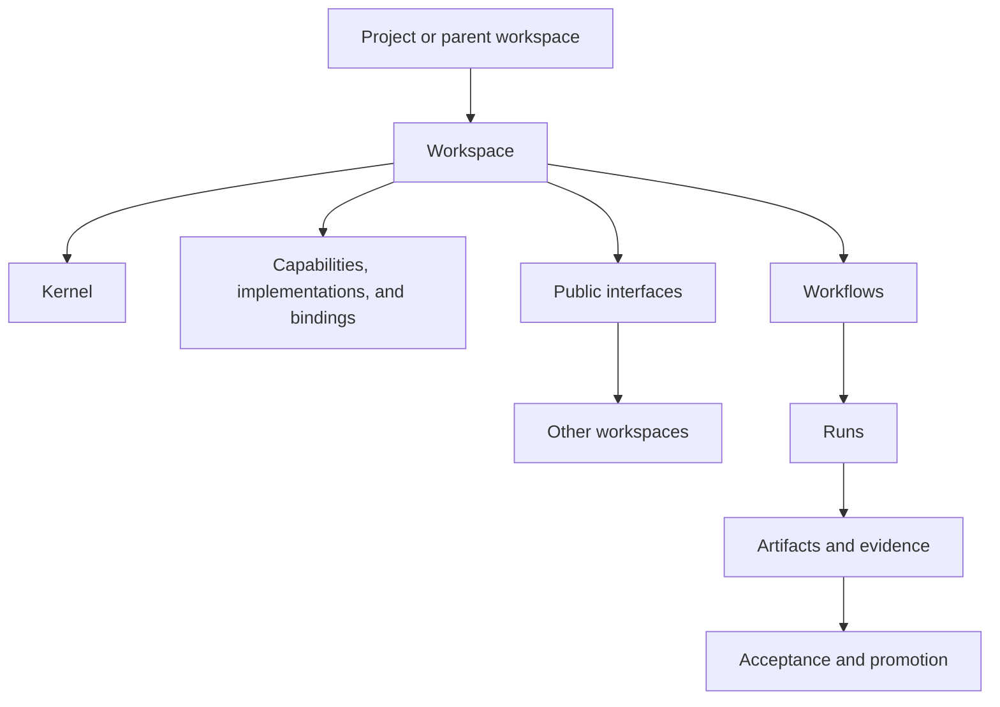

# Core Model

## The Model

A project may contain one or more workspaces. When a project root implements the workspace kernel, it also acts as the parent workspace.

A configured workspace consists of:

```text
Workspace = Kernel + Capabilities + Capability Implementations + Bindings + Workflows + Public Interfaces + Interface Bindings + Working State
```



## Important Concepts

| Concept | Meaning |
|---|---|
| Project | A durable container for a shared outcome or body of work |
| Workspace | A bounded environment that surfaces context and organizes related work |
| Parent workspace | A workspace that provides shared context, authority, and direction to child workspaces through declared contracts and public interfaces |
| Kernel | The minimum information needed to understand, govern, and maintain a workspace |
| [Workspace Interface](07-workspace-interface.md) | A versioned public contract through which another workspace may submit requests and receive declared status, results, failures, evidence summaries, or accepted artifacts |
| Interface Binding | Consumer workspace configuration that selects a provider interface version and the operations it may invoke |
| Capability | A stable contract for a bounded workspace function |
| Capability Implementation | A local or external realization of a Capability |
| Binding | The connection between a Capability requirement and its Capability Implementation |
| Workflow | A reusable, inspectable definition with an entry contract, numbered stages, references, acceptance, and transition rules |
| Stage | A numbered, human-navigable part of a workflow definition with a stage contract |
| Run | One execution of one workflow for a specific request, isolated by an explicit run ID |
| Record | Information created while operating the workspace, such as a decision, work item, or change record |
| Artifact | Material produced or changed during work |
| Evidence | Information used to evaluate a result or claim |
| Acceptance | Confirmation that a result meets its defined standard |
| Promotion | Moving an accepted result to its authoritative destination |
| Maintenance | Keeping workspaces, Capabilities, Capability Implementations, bindings, and workflows valid over time |

The six minimum Capabilities are Context Provider, Context Assembly, Work, Storage,
Evaluation, and Interaction. Context Provider retrieves source material; Context
Assembly selects and combines task-scoped material. Storage is formally the State and
Artifact Store Capability. These are stable contracts. They do not prescribe whether
a human, AI agent, script, service, tool, or mixed team provides the Capability
Implementation.

## How Work Moves

1. A request enters a workspace.
2. The kernel routes the request and establishes context and authority.
3. A workflow uses the Capabilities it requires through selected Capability
   Implementations and bindings.
4. A run records the request-specific work.
5. The run resolves and pins its context and acceptance measures before execution.
6. The run produces isolated artifacts and evidence, organized by workflow stage.
7. Evaluation and declared transition rules determine continuation, stop, or escalation.
8. Acceptance determines whether the outcome meets its standard.
9. Promotion places the accepted result in its authoritative destination.

When work crosses a workspace boundary, the consuming workspace uses a versioned
Workspace Interface. It does not read the other workspace's private context,
bindings, files, drafts, or run state directly.

Completion, acceptance, and promotion are separate events.
